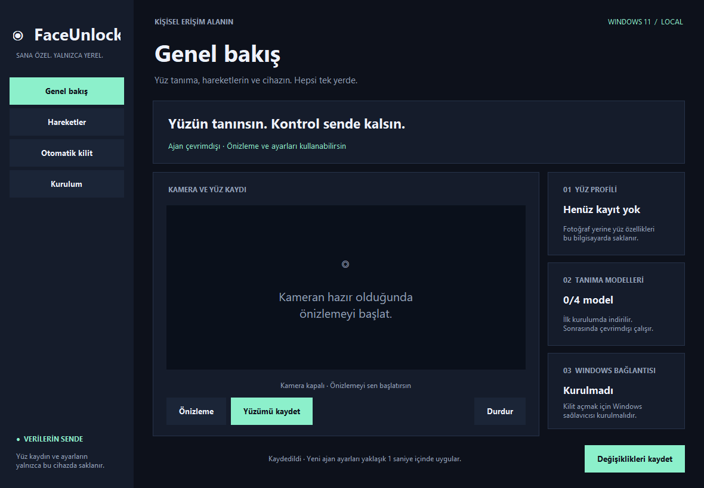

# FaceUnlock · Windows 11

Yerel yüz tanıma, seçilebilir el/mimik hareketleri ve uzaklaşınca otomatik oturum kilitleme. Türkçe masaüstü panelinden kameranı, kilitleme süreni ve kilit açma hareketlerini seç.



**Deneysel bir Windows projesidir.** Standart RGB kamera kullanır; Windows Hello'nun donanım destekli yüz doğrulama seviyesinde değildir. Mevcut oturumun kilidini açar; ilk açılışta oturum açmayı desteklemez. PIN/parola girişi kullanılabilir kalır.

## Özellikler

- Kamera önizlemesi ve panel içinden 25 örnekle yüz kaydı.
- Çift göz kırpma, görsel parmak şıklatma, zafer işareti, başparmak yukarı, Spiderman ve yukarı bakma seçenekleri.
- Önce kayıtlı yüzün eşleşmesi, sonra seçilen hareketlerden herhangi birinin yapılması gerekir. Hareketler bir sıralama/parola dizisi değildir.
- Uzaklaşınca kilitleme için hazır süreler ve 5–3600 saniye özel süre.
- Kaydedilen ayarları yaklaşık bir saniye içinde yeniden okuyan ortak kamera ajanı; devam eden kamera/model işlemleri bu süreyi uzatabilir.
- İlk model indirmesinden sonra çevrimdışı çalışma. Yüz görüntüleri sunucuya gönderilmez.
- Kamera kullanılamıyorsa, örtülüyse veya önizleme açıksa otomatik kilitleme duraklar.
- `Ctrl+Alt+F12` otomatik kilitlemeyi açar/kapatır. Düşük ses: kapalı, yüksek ses: açık.

Bilgisayar kapanmaz veya uykuya geçmez; **oturum kilitlenir, açık uygulamalar korunur**.

## Kaynak koddan başlama

Gerekenler: Windows 11 x64, **Python 3.12 x64** (Python Launcher ile), kamera ve ilk kurulum için internet.

1. Repoyu klonla veya ZIP'i indirip çıkar.
2. `start.cmd` dosyasına çift tıkla. Yerel `.venv` oluşturulur, bağımlılıklar yüklenir, panel açılır.
3. **Kurulum → Modelleri hazırla**. Yaklaşık 50 MB model indirilir ve SHA-256 değerleri doğrulanır.
4. **Genel bakış → Yüzümü kaydet**. Kamerada yalnızca sen ol; başını hafifçe farklı yönlere çevir. Kısmi/iptal edilmiş kayıt eski kaydını değiştirmez.
5. **Hareketler** ve **Otomatik kilit** sekmelerinden seçimlerini yap; **Değişiklikleri kaydet**.
6. **Kurulum → İzlemeyi başlat** ile yalnızca otomatik kilitlemeyi kullanabilirsin. Bu yerel izleme panel kapanınca durur.

Önizlemede yüz eşleşmesini ve hareket algılamasını görebilirsin. Önizleme hiçbir zaman Windows'a kilit açma sinyali göndermez. Tek göz kırpma ve başı sağa/sola çevirme, yanlışlıkla tetiklenebildikleri için sunulmaz.

## Windows kilit açmayı kurma

Kaynak koddan derleme için **Visual Studio Build Tools** içindeki **Desktop development with C++** ve Windows SDK gerekir. Paneldeki **Windows kurulumu** düğmesi eksik bileşenleri derlemeyi dener. Hatalar veri klasöründeki `build.log` dosyasına yazılır.

Alternatif olarak repo klasöründe:

```powershell
.\build.cmd
.\build-agent.cmd
# Sonraki komutu kendi Windows hesabının yönetici PowerShell penceresinde çalıştır:
powershell -ExecutionPolicy Bypass -File .\install.ps1
```

Kurulum Windows hesap **parolasını** gizli girişle sorar; PIN kullanma. Parolayı komut satırına veya GitHub'a yazma. Windows'ta yalnızca Windows Hello ile giriş zorunluluğu açıksa kurulum durur; Windows'un Oturum açma seçeneklerinden bu ayarı kullanıcı değiştirmelidir.

Kurulum bileşenleri `Program Files\FaceUnlock` altına koyar, Başlat menüsüne panel kısayolu ve oturum açılışında başlayan `FaceUnlockAgent` görevi ekler. Önceki `FaceLock` görevi varsa çakışmayı önlemek için durdurulup devre dışı bırakılır. Çalışan eski panelin yerine Başlat menüsündeki yeni paneli kullan.

**Windows'u yeniden başlat**, sonra `Win+L` ile dene. Yüzünü gösterip seçtiğin hareketi yap. PIN/parola girişi kullanılabilir kalır. FaceUnlock seçeneği normalde gizlidir; yüz ve hareket onayından sonra kısa süreli otomatik giriş için görünür.

Yüzünü yeniden kaydedince panelde **Korunan yüz kaydını güncelle** düğmesine bas. Yönetici izni istenir; Windows parolası tekrar sorulmaz. Kod değiştiyse yeniden derle; ajan için `deploy-agent.ps1` mevcut parolayı koruyarak güncelleme yapar. Paneli de güncellemek için tam kurulumu tekrar çalıştır.

## Python gerektirmeyen dağıtım paketi

Geliştirici bilgisayarında:

```powershell
powershell -ExecutionPolicy Bypass -File .\package.ps1
```

Uygulama ve ajan PyInstaller ile paketlenir, DLL derlenir ve `%LOCALAPPDATA%\FaceUnlockBuild\releases` altında tarihli ZIP oluşur. `-SkipBuild` mevcut derlemelerden paket oluşturur. Paket kişisel yüz, ayar, model veya parola içermez.

Paketi alan kullanıcı ZIP'i çıkarıp **FaceUnlock.cmd** dosyasına çift tıklar; Python veya derleyici kurması gerekmez. Modelleri indirir, kendi yüzünü kaydeder ve panelden Windows kurulumunu başlatır. Paket henüz imzasızdır; farklı Windows cihazlarında kurulum ve kilit ekranı doğrulaması ayrıca yapılmalıdır.

## Yerel veriler

Yeni kurulumlarda `%LOCALAPPDATA%\FaceUnlock`; mevcut `~/FaceLock/config.json` bulunursa uyumluluk için eski klasör kullanılır. Repo içinde kişisel veri saklanmaz.

| Dosya | İçerik |
| --- | --- |
| `config.json` | Hareketler, kamera ve süre ayarları |
| `my_face.npy` | Yüz özellik vektörleri; fotoğraf saklanmaz |
| `my_face_adaptive.npy` | Başarılı açılışlardan öğrenilen en fazla 40 örnek |
| `models/` | İndirilen tanıma modelleri |
| `facelock.log` | Çalışma/hata günlüğü |
| `agent_status.json` | Panel için ajan durumu |
| `preview.json` | Önizleme için geçici kamera devralma süresi |

Windows ajanı orijinal yüz kaydını ve modelleri korumalı `Program Files\FaceUnlock\data` klasöründen okur. Paneldeki yeni yüz kaydı yönetici onaylı yenilemeyle buraya taşınır. Parola ayar dosyasına yazılmaz; Windows LSA özel verisinde saklanır.

Uyarlama yalnızca Windows oturumu gerçekten açıldıktan sonra örnek ekler. Orijinal kayıt ve eşik değiştirilmez. Örnekler orijinal kayda en az `0.45` benzemeli; neredeyse aynı örnekler eklenmez. Sıfırlamak için ajan durmuşken `my_face_adaptive.npy` dosyasını sil. Benzerlik skoru yüzde veya ölçülmüş yanlış kabul olasılığı değildir.

## Kamera davranışı

Kilit açıkken otomatik kilit izleme kamerayı kullanır. Kilitliyken giriş etkinliğinde ve yaklaşık her dört saniyede bir yüz taraması yapılır; tarama başlangıç için en az 1.8 saniye açık kalır. Yüz görünürse devam eder. Kamera beklemesi `0` ise kilitliyken sürekli açıktır. Donanıma bağlı kamera LED'i yazılımla kapatılamayabilir.

Önizleme/yüz kaydı tek kamerayı geçici olarak devralır. Kamera açılmıyorsa kamera numarasını, Windows kamera izinlerini ve diğer kamera uygulamalarını kontrol et. Eski ajanlar panelin duraklatma dosyasını okumaz; paneli kullanmadan önce yeni sürümü kur.

## Kaldırma

Kendi Windows hesabının yönetici PowerShell penceresinde repo/paket klasöründen:

```powershell
powershell -ExecutionPolicy Bypass -File .\install.ps1 -Remove
```

Sağlayıcı kaydı, ajan görevi, Başlat menüsü kısayolu ve LSA parola kaydı kaldırılır. Daha önce etkin eski `FaceLock` görevi varsa yeniden etkinleştirilir. Kişisel yüz ve uygulama dosyaları otomatik silinmez. Yeniden başlatmadan sonra `Program Files\FaceUnlock` ve istersen veri klasörünü silebilirsin.

Kilit ekranı sağlayıcısı sorun çıkarırsa Windows Güvenli Mod'da aynı kaldırma komutunu çalıştır. Diğer giriş yöntemleri filtrelenmez.

## Kontroller

```powershell
python -m unittest settings_smoke agent_smoke -v
python decision_smoke.py
python adaptive_smoke.py
python blink_smoke.py
python camera_scan_smoke.py
python snap_smoke.py
python ui_smoke.py
.\build.cmd
.\smoke.cmd
```

`ui_smoke.py` geçici veriyle paneli ve ayar kaydını test eder; kamera açmaz, Windows'u kilitlemez. `--screenshots` yalnızca panel penceresini `artifacts/` altına kaydeder. Gerçek kilit ekranı açılması ve farklı kamera/aydınlatma koşulları cihaz üzerinde ayrıca test edilmelidir.

Güvenlik sınırları [SECURITY.md](SECURITY.md), dış bileşenler [THIRD_PARTY.md](THIRD_PARTY.md) içindedir.
